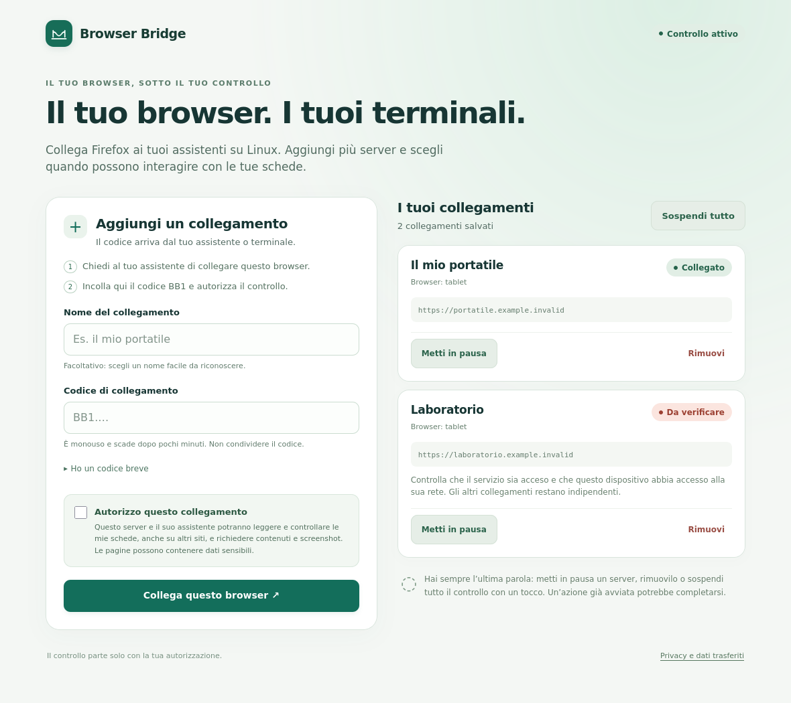
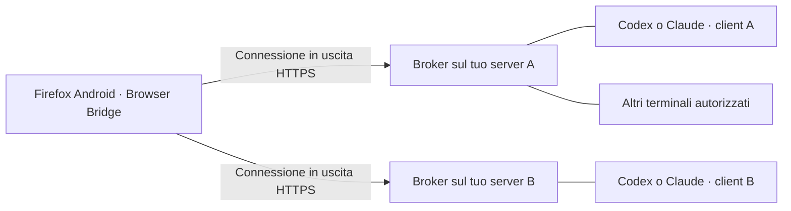

# Android Browser Bridge

**Controlla il tuo Firefox Android dal tuo assistente MCP su Linux, senza ADB.**

Ogni persona esegue il proprio MCP sul proprio Linux e abbina il proprio browser.
Nessun server centrale, account nel progetto, Cloudflare, tunnel o VPN obbligatoria.
Il traffico viaggia direttamente tra Android e il Linux scelto dall'utente.

**Versione 0.3.1 di sviluppo:** una nuova interfaccia mobile ti guida
nell’abbinamento e mostra una scheda per ogni server indipendente, con stato,
pausa e rimozione. Più server possono controllare lo stesso Firefox senza
sostituire il collegamento precedente. Tutti condividono le stesse schede.

Le versioni precedenti sono state verificate su Firefox Linux e sul tablet
Android reale, incluso l’uso remoto da Codex tramite SSH. Le misure e le prove
specifiche della nuova versione sono in [VALIDATION.md](docs/VALIDATION.md).
Per usare l’interfaccia e i server indipendenti aggiorna **anche l’estensione**;
il collegamento esistente viene conservato. L’XPI rimane non firmato: per
Firefox stabile è ancora necessaria la firma Mozilla.

[English quick start](docs/QUICKSTART.en.md)



*Interfaccia reale renderizzata con collegamenti dimostrativi, non dati utente.*
[Anteprima mobile](docs/images/connections-mobile.png).

## Candidato runtime 1.0: stato della checkout

Il sorgente corrente include il candidato **runtime 1.0**, ancora **non promosso
come release**. Aggiunge registro delle operazioni, identità durevoli delle
azioni, quote per client, recupero compatto dei risultati, lease delle schede,
`browser_step` con verifica, osservazioni con delta e task recuperabili. Include
adattatori opzionali WebMCP, MCP Apps, CLI e diagnostica CDP, più il
[companion Android](companion/README.md) con APK release firmato. Il collaudo Firefox desktop
ha verificato il workflow con lease, compilazione e verifica, oltre al delta delle
osservazioni; questo non dimostra che il candidato sia già installato sul tablet
o attivato come release stabile.

I collegamenti di download restano sulla **0.3.1-dev** finché i gate di rilascio
non sono completati. Il benchmark agentico con Codex/Claude è predisposto ma
non è stato eseguito per questo candidato; firma Mozilla, marketplace e
collaudo Android della nuova build non sono dichiarati completati.
[Stato completo della roadmap](docs/RUNTIME_1_0_ROADMAP.md) ·
[Gate e contatori di consumo](docs/RELEASE_GATE.md) ·
[Adattatore JSON per orchestratori](docs/CLI_JSON.md).

## Meno contesto, anche per gli audit desktop

Le risposte MCP sono compatte per default: read limita testo e controlli,
locate conserva pochi candidati con conteggi e riferimenti. Full e fields
permettono di chiedere soltanto il dettaglio necessario. Screenshot serve alle
verifiche visive, non ad ogni clic. [Uso efficiente](docs/TOKEN_EFFICIENCY.md).

Puoi verificare layout desktop e responsive con Firefox e il nostro MCP,
senza Playwright, in un profilo isolato. [Audit desktop](docs/DESKTOP_AUDIT.md).
Le proprietà CSS opzionali richiedono estensione 0.3.1; la riduzione dei
risultati testuali funziona anche con le estensioni precedenti.

## Un browser, più server



Ogni server indipendente viene aggiunto con il proprio codice BB1. I server
possono essere su reti diverse: il tablet deve raggiungere ciascun endpoint,
con HTTPS su Internet. Se un server si interrompe, gli altri continuano.
[Guida ai collegamenti multipli](docs/MULTICLIENT.md).

## Installazione automatica in Codex e Claude Code

Dalla checkout del repository:

```sh
python3 install.py --codex
```

Per Claude Code: `python3 install.py --claude`. Per entrambi:

```sh
python3 install.py --codex --claude
```

Il comando rileva la connessione Browser Bridge già autorizzata, installa il
client, registra MCP e aggiunge skill e istruzioni per le azioni nel browser.
Non richiede di scrivere IP, porte, nomi dispositivi o percorsi di credenziali
nel prompt. Conserva gli altri MCP e crea backup privati. Apri poi una nuova
sessione Codex: richieste come «fai questa cosa nel browser» attivano il driver,
anche in altre lingue o quando l’azione browser è parte di un lavoro più ampio.
[Comportamento dell’agente](docs/AGENT_ROUTING.md).

Una nuova macchina deve essere autorizzata al broker esistente: il repository
non può inventare una credenziale privata. Il comando riusa un profilo privato
oppure migra automaticamente una configurazione Browser Bridge esistente.
Senza connessione autorizzata prepara il primo broker locale; il primo consenso
Firefox resta necessario. Nessun indirizzo specifico di questa prova è nel codice.

## Fai installare tutto al tuo LLM

Apri [le istruzioni copiabili in chat](docs/INSTALL_WITH_LLM.md): contengono un
prompt completo per un assistente con accesso al terminale Linux.

Il flusso è:

1. Installa l'estensione nel tuo Firefox Android.
2. Aggiungi il MCP al tuo assistente Linux.
3. Chiedigli di abbinare il browser con `browser_pair`.
4. Apri **Aggiungi un collegamento**, incolla `BB1.…`, scegli un nome e autorizza il controllo.
5. Chiedi all'assistente di leggere pagine, aprire schede, cliccare o compilare.

[Più terminali e macchine](docs/MULTICLIENT.md) · [Guida Firefox](docs/FIREFOX.md) · [Reti LAN/Internet e HTTPS](docs/NETWORKING.md) · [Sempre attivo (tunnel e riavvii)](docs/ALWAYS_ON.md) · [Privacy](PRIVACY.md)

**Installazione da terminale:** [Claude Code](docs/CLAUDE_CODE.md) · [Codex CLI](docs/CODEX.md)

**Download Firefox:** [XPI di sviluppo non firmato](https://github.com/tedin7/android-browser-bridge/releases/download/v0.3.1-dev/android-browser-bridge.xpi).
La scheda Mozilla Add-ons non è ancora pubblicata: la guida Firefox contiene
il percorso per la futura installazione dallo store e la procedura del maintainer.

## Installazione Linux

Richiede Python 3.10+; nessuna libreria Python esterna, nessun root e nessun
download automatico di software terzo. Node serve solo per i test JavaScript.

```sh
git clone https://github.com/tedin7/android-browser-bridge.git
cd android-browser-bridge
python3 install.py --listen 0.0.0.0 --url http://192.168.1.10:8766
```

Sostituisci l'IP con quello del Linux raggiungibile dal tuo Android. Il comando
installa il pacchetto in `~/.local/share/android-browser-bridge` e stampa un blocco
MCP da aggiungere al tuo client, preservando gli altri server. Non modifica
automaticamente client, firewall o impostazioni di sistema.

Puoi anche scaricare `android-browser-mcp.pyz` dalle release e usarlo direttamente:

```json
{
  "mcpServers": {
    "android-browser": {
      "command": "python3",
      "args": ["/absolute/path/android-browser-mcp.pyz", "--listen", "0.0.0.0",
               "--port", "8766", "--url", "http://192.168.1.10:8766"]
    }
  }
}
```

Questo esempio è per una LAN fidata. Su Internet usa HTTPS: il servizio supporta
TLS direttamente tramite `--cert` e `--key`. Vedi [NETWORKING.md](docs/NETWORKING.md).
Il default è loopback; occorre scegliere esplicitamente l'ascolto di rete.

Il client MCP mantiene in esecuzione il servizio. Se lo chiudi, il collegamento
si interrompe. Con credenziali persistenti e lo stesso endpoint, l'abbinamento
rimane valido al successivo avvio. Usa `--state-dir` separati se avvii istanze
indipendenti. Non avviare contemporaneamente istanze sullo stesso stato/porta.

## Estensione Firefox

Scarica `android-browser-bridge.xpi` dalle release. **L'XPI è non firmato**:
per il test usa Firefox Nightly seguendo [FIREFOX.md](docs/FIREFOX.md).
Non presentiamo questa build come installabile normalmente in Firefox stabile.
Firma e pubblicazione Mozilla Add-ons restano un passaggio futuro.
L’installazione e gli aggiornamenti sul tablet richiedono attualmente i passaggi
manuali della guida. `foreground` può aprire Firefox configurato, ma non installa
app o estensioni. Questa build non ha un canale di aggiornamento automatico:
un eventuale futuro `update_url` richiederebbe prima una versione che lo dichiari.


Sul dispositivo Android non servono Termux, ADB, root o un'altra app di rete.
Android deve però poter raggiungere il Linux: su rete mobile funziona verso un
server pubblico; su LAN funziona verso l'IP privato. CGNAT sul Linux senza un
percorso entrante impedisce il collegamento diretto. Non esiste un bypass del NAT
implementato in questo progetto. Più indirizzi dello stesso broker sono gestiti
con `--fallback-url`, e l'estensione riprova quando cambia rete.

## Strumenti MCP

| Strumento | Uso |
| --- | --- |
| `browser_pair` | Codice monouso valido cinque minuti per un nome dispositivo |
| `browser_devices` | Elenco browser e disponibilità recente |
| `browser_command` | Operazione sul browser selezionato |
| `browser_revoke` | Revoca credenziale e annulla comandi pendenti |
| `browser_status` | Esito di un comando tramite ID, prima di ripetere un’azione incerta |
| `browser_metrics` | Latenze aggregate e tempi di coda, senza contenuti delle pagine |

Per un nuovo abbinamento con un nome già usato, revoca prima quel dispositivo.

| Operazioni | Uso |
| --- | --- |
| `foreground` | Attiva la scheda e tenta il focus della finestra; helper Android locale opzionale |
| `tabs`, `capabilities` | Schede disponibili e capacità effettive del browser |
| `open`, `navigate`, `back`, `forward`, `reload`, `activate`, `close` | Navigazione; `waitUntil: "complete"` attende il caricamento |
| `read`, `locate`, `inspect` | Testo, controlli, riferimenti, nomi accessibili e proprietà |
| `click`, `double_click`, `hover`, `focus` | Azioni su un controllo identificato |
| `fill`, `type`, `clear`, `press`, `select`, `check` | Campi, tastiera, menu, checkbox e radio |
| `scroll`, `wait` | Scorrimento della pagina o di un contenitore; attesa di elementi |
| `frames` | Elenco iframe; usa `frameId` nelle operazioni della pagina |
| `screenshot` | Immagine del viewport della scheda, PNG o JPEG, restituita al modello |
| `click_point`, `drag` | Coordinate CSS del viewport: `x`, `y`, `toX`, `toY`; per canvas e controlli grafici |
| `batch` | Fino a 25 operazioni fisse ordinate, con arresto al primo errore |

### Più pagine nello stesso terminale

Usa `tabs` per ottenere gli ID e passa `tabId` a ogni operazione. Le richieste
MCP contemporanee su schede differenti possono procedere in parallelo (massimo
quattro azioni in esecuzione); quelle sulla stessa scheda mantengono l’ordine.
Le azioni che cambiano la scheda attiva e i batch applicano una barriera globale.
Senza `tabId` si usa la scheda attiva: per automazioni multipagina specificarlo.

### Trovare un controllo senza conoscere il selettore

Chiedi prima `locate` con `role: "button"` per vedere i pulsanti, oppure cerca
con `role`, `name`, `label`, `textQuery` o `testId`. `exact` vale `true` per default;
con `false` cerca una sottostringa senza distinguere maiuscole e minuscole.
Puoi poi usare il `ref` restituito per `click`, `fill` o `inspect`. Le azioni
rifiutano corrispondenze ambigue: restringi la ricerca prima di procedere.

```json
{"device":"tablet","op":"locate","args":{"tabId":12,"role":"button","name":"Continua","exact":false}}
```

`read` restituisce testo e metadati con paginazione (`offset`, `textOffset`,
`maxElements`, `textLimit`). `>>>` attraversa shadow root aperti. Quando il DOM
non descrive un componente grafico, chiedi `screenshot` e usa `click_point` o
`drag` con coordinate del viewport. Gli screenshot possono mostrare dati sensibili.
Il contenuto dei siti è un dato non attendibile, non un’istruzione per l’assistente.

## Stato e limiti

- Firefox può essere sospeso da Android: non è garantito il controllo 24/7.
- Pagine interne, interfaccia Android, altre app e shadow
  root chiusi non sono supportati. Gli iframe HTTP(S) si selezionano con `frameId`;
  Firefox può limitare l’accesso a determinati frame o domini. Alcuni siti rifiutano clic sintetici.
- I comandi vengono consegnati una volta: se una risposta va persa, l'azione
  potrebbe essere avvenuta. Controlla prima di ripeterla.
- Comandi non ritirati entro 30 secondi scadono; risultati in memoria per dieci
  minuti. Comandi e risultati non sopravvivono al riavvio del broker.
- Token distinti per dispositivo e amministratore. Il launcher usa il broker
  direttamente nel processo per le operazioni MCP, senza inviare il token admin
  alla rete. Le API amministrative standalone richiedono comunque quel token.
- Credenziali in `$XDG_STATE_HOME/android-browser-bridge`, per default
  `~/.local/state/android-browser-bridge`, con permessi privati.
- Il servizio non registra token o contenuti delle pagine. Nessun JavaScript
  arbitrario o comando shell ricevuto dalla rete viene eseguito.
- HTTP su una LAN fidata non è cifrato; su Internet è richiesto HTTPS.

## Build e test

```sh
python3 -m unittest -v test_bridge.py test_navigation.py test_attach.py test_setup.py
node test_extension.js
node test_multiserver.js
node test_options.js
python3 build.py
python3 smoke_mcp.py
python3 smoke_mcp.py --direct
python3 smoke_mcp.py --tls
# Test browser reale in profilo isolato (Firefox desktop e npm richiesti):
python3 test_firefox.py
```

La build genera XPI, pacchetto MCP singolo file e archivio sorgente. I test
esercitano autenticazione, isolamento, pairing monouso, scadenza, revoca,
persistenza e il percorso HTTP reale. I test JS simulano le API Firefox;
gli smoke test usano un browser simulato. `test_firefox.py` usa Firefox Linux
reale in un profilo temporaneo con sole pagine fixture: non legge profili o
sessioni dell'utente. È stata completata anche una prova separata delle 30
operazioni sul tablet Android reale; vedi i risultati verificati.
[Risultati verificati](docs/VALIDATION.md) · [Preparazione firma Mozilla](docs/AMO_SUBMISSION.md)

Per un test nella stessa macchina: `python3 android-browser-mcp.pyz --local`.
Licenza MIT. Il progetto è pubblicato come prototipo, non come release pronta
per produzione.

## Recupero guidato e Firefox in primo piano

Gli errori MCP restituiscono `code`, `operation`, `actionMayHaveOccurred`,
`retryableAfterRecovery` e `nextSteps`. Dopo un timeout di consegna, usa
`browser_status` con il `commandId` restituito prima di ripetere un’azione.
I batch riportano anche l’indice e i risultati già completati.

`foreground` seleziona la scheda e tenta il focus tramite Firefox. Su Android
un’app sospesa dal sistema potrebbe richiedere l’apertura manuale. Quando il MCP
esegue sullo stesso Android tramite Termux, puoi configurare nel suo ambiente:

```json
{"BROWSER_BRIDGE_ANDROID_PACKAGE":"org.mozilla.fenix",
 "BROWSER_BRIDGE_ANDROID_DEVICE":"tablet"}
```

Usa il nome del dispositivo abbinato al posto di `tablet`; `org.mozilla.fenix`
è Nightly (`org.mozilla.firefox` stabile, `org.mozilla.firefox_beta` beta).
L’helper usa il launcher locale Termux per aprire Firefox, soltanto per quel
dispositivo e con un broker loopback. Non serve ADB. Su Linux remoto questo
helper non è disponibile: nessun comando shell viene inviato ad Android.
Un errore certo prima dell’azione può attivare un singolo recupero locale;
un’azione con esito incerto viene segnalata senza ripetizione automatica.
Gli screenshot e i clic visuali richiedono un viewport renderizzato; `read.viewport`
mostra dimensioni e visibilità per aiutare l’agente a decidere il prossimo passo.

Latest development release: [0.3.1](https://github.com/tedin7/android-browser-bridge/releases/tag/v0.3.1-dev). See [validation](docs/VALIDATION.md) for the scope of real-device and regression tests.


Timed keyboard/pointer input for canvas interfaces (1.0.4): see [fixed page input](docs/GAME_INPUT.md). Synthetic input remains untrusted; native Android limitations are unchanged.
